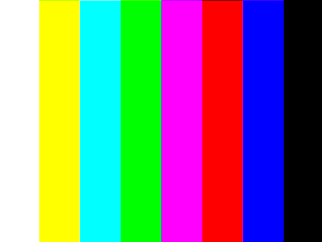
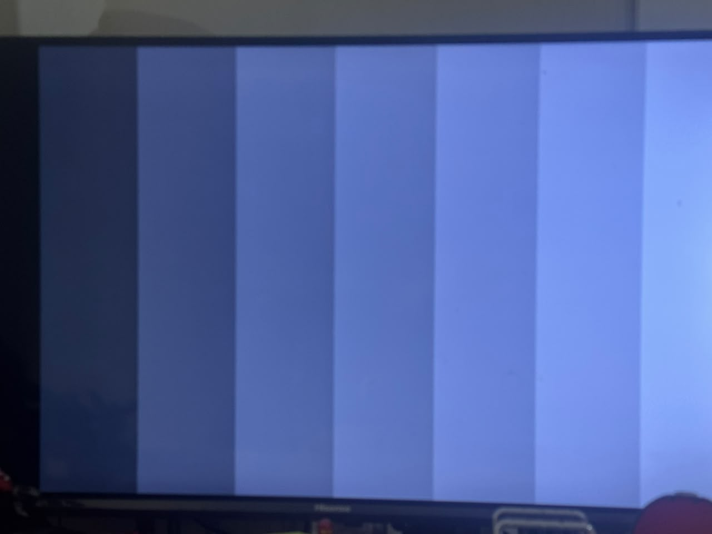

# Zybo Z7-10 OV5647 Bayer vision demo

## Latest build update (21 October 2026)

The current checked-in build sets the bright-pixel threshold to 192 and draws a two-pixel red outline around the previous completed frame's bounding box. The outline appears one frame later because the detector latches coordinates at frame end. The RTL simulation passes; Vivado 2025.2 routed the updated system with WNS +0.599 ns, 8,400 LUTs, 13,402 registers, 9 BRAM tiles, and zero DRC errors. The matching bitstream and XSA are in `artifacts/`.

The owner supplied a photo of the Zybo HDMI test pattern displayed on a TV. A separate local-only optical capture gave 552 threshold hits and a box at x=296..380, y=180..286 for threshold 192. That capture was used only to choose the initial threshold and is not included in this repository. The threshold-192 build has not yet been confirmed on the physical board: the latest JTAG attempt found the FPGA but the Zynq ARM/DAP target did not respond. See [current limitations](docs/test_results.md).

This portfolio project receives VGA RAW10 from a Raspberry Pi Camera Rev 1.3 / OV5647 over two lane MIPI CSI-2, converts it to Bayer8, writes frames to DDR with AXI VDMA, then reads them through custom Bayer-to-RGB and bright-region RTL before HDMI TX.

**Camera capture evidence (earlier hardware run):** The OV5647 sent 640x480 RAW10 over CSI-2; the design wrote Bayer8 frames to DDR over VDMA, and a frame was recovered over JTAG and reconstructed as the RGB PNG below. Detector GPIO readback in the earlier threshold-32 build reported 76,800 hits and box x=160..479, y=120..359 while the sensor color bars were enabled. The owner also supplied a TV photo showing an HDMI color-bar test pattern. That photo confirms HDMI TX output from the earlier test; it does not prove live camera-to-TV video or the latest red-box overlay.



The photo below is the owner's TV photo of the earlier Zybo HDMI color-bar output. It is hardware evidence for HDMI TX on that earlier build; it does not show the new threshold-192 overlay.



The image is reconstructed on the laptop from the board's DDR Bayer8 frame dump using the repository's Python reference for the same causal interpolation used in RTL. It demonstrates camera reception, DDR capture, and the Bayer interpretation; it is not a TV/HDMI screenshot. The test image was made with the sensor's color-bar pattern enabled. The JTAG raw dump stays under ignored `build/capture/` and is not committed.

## Hardware path

```text
OV5647 RAW10 → MIPI CSI-2 RX → RAW10/Bayer8 + frame monitor → AXI VDMA S2MM → DDR
                                                                                ↓
HDMI OUT ← rgb2dvi ← Video Out/VTC ← ROI detector ← Bayer-to-RGB ← AXI VDMA MM2S
```

The MIPI physical receiver and CSI-2 packet receiver use AMD IP. The custom RTL contribution performs stream demosaicing, frame checks, bright-pixel counting, and bounding-box tracking.

### Bayer-to-RGB

`rtl/axis_bayer_demosaic.v` defaults to BGGR. It uses the current, left, upper, and upper-left Bayer samples to estimate missing channels, averages available samples of each color, and uses the current sample at borders where a channel is unavailable. This is a compact causal approximation that needs one 8-bit line buffer and preserves AXI ready/valid and SOF/EOL sidebands. It is not a full symmetric bilinear filter. The current capture path discards the low two bits of RAW10 when forming Bayer8.

### Measurable detection

`rtl/axis_bright_roi_detector.v` computes luma as `(R + 2G + B) / 4`, counts pixels at or above 192 in the central 320x240 region (x=160..479, y=120..359), and latches the count and bounding box at each completed 640x480 frame. The RTL paints a two-pixel red border around the last completed box in the following frame. Metrics connect to AXI GPIO for processor readback. This is a brightness threshold demonstration, not object classification.

See [register map and measurement method](docs/bayer_rgb_detection.md), [verification results](docs/test_results.md), and [hardware bring-up log](docs/hardware_bringup_2026-10-21.md).

## Build and test

Run in PowerShell from the repository root:

```powershell
python -m unittest discover -s host -p 'test_*.py' -v

$sim = Join-Path (Get-Location) 'build\sim_bayer'
New-Item -ItemType Directory -Force $sim | Out-Null
Push-Location $sim
& 'C:\AMDDesignTools\2025.2\Vivado\bin\xvlog.bat' -sv `
  ..\..\rtl\axis_bayer_demosaic.v `
  ..\..\rtl\axis_bright_roi_detector.v `
  ..\..\sim\tb_axis_bayer_vision.sv
& 'C:\AMDDesignTools\2025.2\Vivado\bin\xelab.bat' tb_axis_bayer_vision -s tb_axis_bayer_vision
& 'C:\AMDDesignTools\2025.2\Vivado\bin\xsim.bat' tb_axis_bayer_vision -runall
Pop-Location
```

The full design build and XSA export are `fpga/build_system.tcl` and `fpga/export_xsa.tcl`. The generated deliverables are copied to `artifacts/`. Review [routed timing and utilization](docs/system_routed_timing.txt) and [DRC](docs/system_drc.txt) after a rebuild. The build uses Vivado 2025.2 and the local Digilent `rgb2dvi` IP under `fpga/ip_repo`.

## Board setup

Connect the camera's 15-pin ribbon to the Zybo Pcam connector with the board powered off, and connect Zybo **HDMI OUT** to a monitor or capture device. USB JTAG is used for configuration and the frame dump. The HDMI path is started through volatile JTAG register writes; there is no boot firmware that autonomously configures the camera yet. The Ethernet cable is not used by this milestone, and Ethernet video streaming is not implemented.

Useful scripts:

- `fpga/enable_camera_power_jtag.tcl` enables the Pcam power GPIO.
- `fpga/configure_ov5647_vga_jtag.tcl live` configures VGA RAW10 live sensor output; pass `bars` to enable the sensor test pattern.
- `fpga/set_ov5647_live_controls_jtag.tcl` disables the test pattern and enables auto exposure/gain.
- `fpga/start_camera_hdmi_jtag.tcl` starts VDMA capture and HDMI playback.
- `fpga/check_camera_hdmi_jtag.tcl` checks fresh CSI/VDMA status.
- `fpga/capture_vga_probe_jtag.tcl` captures then stops S2MM; `fpga/dump_vga_frame_jtag.tcl` saves the Bayer8 frame under ignored `build/capture/`.
- `host/bayer8_to_rgb.py` converts a raw dump to RGB PNG, for example:

  ```powershell
  python host\bayer8_to_rgb.py build\capture\ov5647_colorbars_640x480.raw docs\captures\frame.png --phase BG
  ```

The owner confirmed the earlier color-bar output on a TV connected to Zybo HDMI OUT. The red-box threshold-192 build is ready in `artifacts/`; its on-board display still needs a fresh JTAG run. A laptop HDMI connector is commonly output-only; a USB HDMI capture device is required to view Zybo HDMI on such a laptop.

## Portfolio framing

This demonstrates MIPI CSI-2 camera bring-up, AXI4-Stream processing, line-buffered RTL, frame-level measurement, DDR/VDMA integration, HDMI output integration, simulation, and timing closure on a resource-constrained Zynq-7000 device. It is a camera-interface/vision subsystem example relevant to automotive camera and ADAS interface roles. Do not describe the detector as a validated automotive perception function; it is a threshold-and-bounding-box demonstration.
