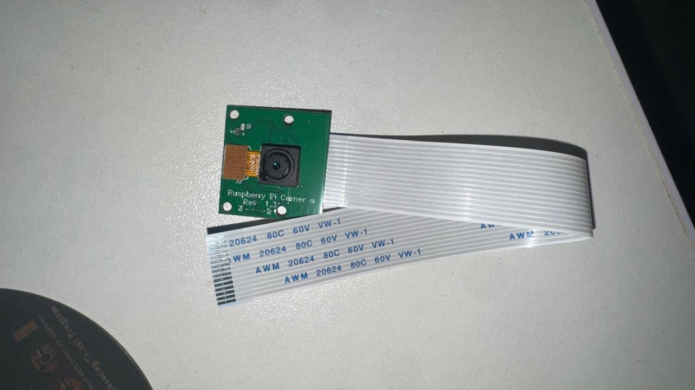

# Prerequisites and setup

This guide reproduces the **OV5647 camera → Zybo Z7-10 → Ethernet → laptop YOLO** path measured in this project. The Zybo also has an HDMI output path, but a stable live camera image and the FPGA red-box overlay have not yet been visually confirmed on the TV. YOLO object predictions run on the laptop, not in the FPGA.

## Hardware



The owner's photo shows the Raspberry Pi Camera Rev 1.3 module and cable **off the Zybo**. It identifies the camera hardware; it does not demonstrate how either cable end was seated on the powered board.

| Required | Purpose |
| --- | --- |
| Zybo Z7-10 (XC7Z010) and suitable 5 V board power | Zynq programmable logic, ARM processor, DDR, Ethernet, and HDMI TX. |
| Raspberry Pi Camera Rev 1.3 / OV5647 with 15-pin flat cable | Two-lane MIPI CSI-2 RAW10 image source. The tested mode is 640 × 480. |
| USB cable to Zybo **PROG UART** | JTAG programming and optional serial logs. Use a data-capable cable. |
| Ethernet cable between Zybo and Windows laptop | Carries Bayer8 video packets to the laptop. A router and HDMI cable are not required for this path. |
| Optional TV/monitor and HDMI cable | For the separate FPGA HDMI OUT path. Connect Zybo **HDMI TX/OUT** to the display input. |

With power **off**, insert the ribbon into the Zybo Pcam connector between its HDMI ports. At the Zybo end, [Digilent's board manual, section 15](https://digilent.com/reference/_media/reference/programmable-logic/zybo-z7/zybo-z7_rm.pdf) specifies that the exposed contacts face the board's top edge, away from its center. Fully insert the cable and close the connector latch. Check that the camera-end ribbon is also fully seated and latched; the photo above does not establish its contact orientation. Do not move or reseat the ribbon while powered. A prior session temporarily saw I²C sensor ID `0x5647` but zero CSI packets; after a board power cycle, CSI and Ethernet frames returned.

## Software and generated prerequisites

The tested workstation used Windows PowerShell, Python 3, Vivado 2025.2, and Vitis/XSCT 2025.2 under `C:\AMDDesignTools\2025.2`. Install the laptop dependencies from `host/requirements-ml.txt`. The checked-in `artifacts/zybo_camera_system.bit` and `.xsa` are the matching FPGA configuration and hardware handoff. The `fpga/ip_repo` directory contains the HDMI IP copy used by the build.

The following files are **generated locally and not included in Git**:

| Local file | How it is used |
| --- | --- |
| `build/jtag/ps7_init.tcl`, `build/jtag/hdmi_bars_640x480.bin` | Created from the XSA by `python fpga/prepare_hdmi_smoke.py`. The startup script needs the pixel clock even for Ethernet-only viewing. |
| `build/hsi_eth_bsp/ps7_cortexa9_0/lib/libxil.a` and `liblwip4.a` | Vitis standalone Cortex-A9 BSP with lwIP, required by `firmware/build_ethernet_stream.ps1`. |
| `build/ethernet_stream.ld` | Local linker script required by the same firmware build. |
| `build/ethernet_stream.elf` | Compiled Zynq UDP sender, loaded into RAM over JTAG. |
| `runs/indoor/homeobjects3k_yolo11n_320/weights/best.pt` | Laptop YOLO checkpoint. Recreate it using the [training instructions](indoor_object_detection.md#fine-tuning-on-public-data) if absent. Downloaded data and model weights are not committed. |

**Fresh-clone limit:** The repository does not yet generate the Vitis BSP or linker script automatically. On the tested workstation, those local prerequisites already exist. A fresh clone needs a matching Vitis standalone `ps7_cortexa9_0` domain with lwIP and a compatible linker script before the Ethernet firmware build command will succeed. The build script checks for these files and reports a missing dependency if needed. The FPGA RTL, simulation, and Vivado build can be explored without the laptop model.

## Start the live Ethernet viewer on the tested workstation

Open PowerShell at the repository root. Install the laptop packages and prepare the XSA-derived JTAG files:

```powershell
python -m pip install -r host\requirements-ml.txt
python fpga\prepare_hdmi_smoke.py
powershell -NoProfile -ExecutionPolicy Bypass -File firmware\build_ethernet_stream.ps1
```

Connect board power, PROG UART USB, and Ethernet. The tested sender uses `169.254.80.26` and UDP port `5005`; the laptop's wired interface was `169.254.80.25/16`. Check the laptop address with `ipconfig`. If configuring it manually, use `169.254.80.25` with mask `255.255.0.0` on the wired adapter. The board broadcasts to `169.254.255.255:5005`.

Program the volatile bitstream, initialize PS/DDR, enable and configure the camera, and start the sender:

```powershell
$env:TEMP = Join-Path (Get-Location) 'build\hw_tmp'
$env:TMP = $env:TEMP
$env:XILINX_LOCAL_USER_DATA = 'NO'
New-Item -ItemType Directory -Force $env:TEMP | Out-Null
& 'C:\AMDDesignTools\2025.2\Vitis\bin\xsct.bat' fpga\start_ethernet_stream_jtag.tcl
```

The script should end with `ZCAM_ETHERNET_SENDER_RUNNING`. **Repeat this JTAG step after every board power cycle**; this setup does not boot from flash or SD. On the tested board, the script also starts HDMI playback, but Ethernet viewing does not need a display cable.

In another PowerShell window at the repository root, start the laptop viewer:

```powershell
python host\zybo_live_detect.py --bind 0.0.0.0 --port 5005 --model runs\indoor\homeobjects3k_yolo11n_320\weights\best.pt --phase BG
```

Press `q` in the viewer to stop. To capture exactly 10 seconds without a display window, add `--seconds 10 --no-display --save-frames --save-dir build\zybo_live\my_capture`. The annotated JPEGs and per-box CSV remain under the ignored `build/` directory until you explicitly select images for publication. A measured room-view run reconstructed 45 complete frames from 9,901 packets in 10 seconds with zero drops or bad packets; the laptop averaged about 4.5 processed frames/s. The [evidence page](live_ethernet_detection.md) shows actual lamp, table, and chair predictions and distinguishes visually plausible from unverified boxes.

## Check the FPGA and diagnose common problems

Run these in PowerShell with the same XSCT environment variables set above:

```powershell
& 'C:\AMDDesignTools\2025.2\Vitis\bin\xsct.bat' fpga\read_ov5647_id_jtag.tcl
& 'C:\AMDDesignTools\2025.2\Vitis\bin\xsct.bat' fpga\check_camera_hdmi_jtag.tcl
```

- Sensor ID should be `0x5647`. CSI packet count should increase between the script's two reads. S2MM is the DDR camera write channel; MM2S is the HDMI read channel. Register activity alone does not prove a clean TV image.
- Ethernet LINK/ACT only proves a physical link. If frames do not arrive, check the wired IP address, `ping 169.254.80.26`, and the Zybo UART logs. The sender needs the correct 1 Gb/s GEM mode, which is set in `firmware/ethernet_stream.c`.
- If I²C sees `0x5647` but CSI packets stay at zero, power the board off before checking both ribbon latches and contacts. Re-run the JTAG startup after powering on.
- If the TV looks distorted, photograph the screen and compare it with a saved Ethernet frame. The live HDMI path and threshold-192 FPGA overlay are still under investigation; do not use the TV image as proof of object detection until visually checked.

For RTL simulation, timing, and the Vivado build, see the [README build section](../README.md#build-and-test) and [verification results](test_results.md). For the indoor model training and its validation metrics, see [indoor object detection](indoor_object_detection.md).
