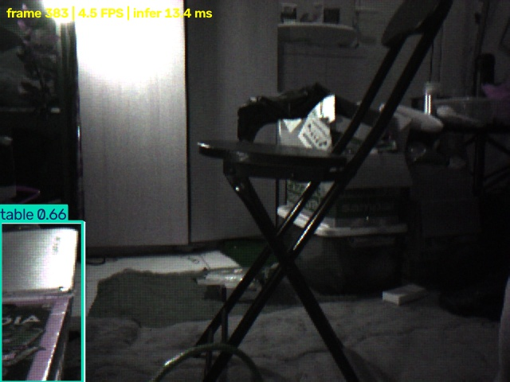
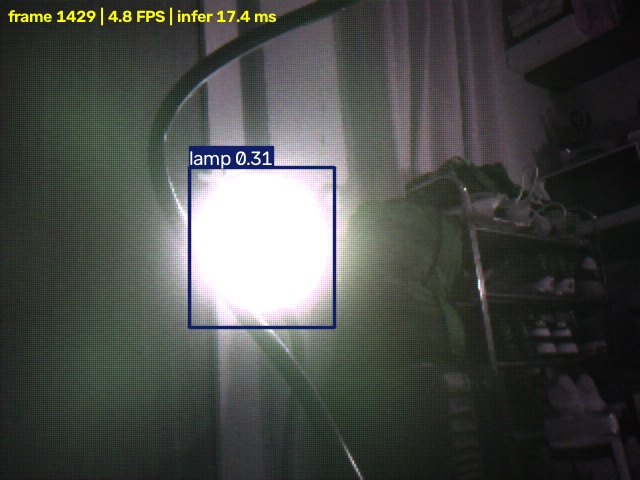

# Live Zybo Ethernet detection

This path sends 640x480 Bayer8 frames from the OV5647/VDMA DDR buffers as CRC-protected UDP packets to the laptop. The laptop reassembles each frame, demosaics it with OpenCV, runs YOLO, displays boxes with class labels and confidence, and writes one CSV row per detected box. Neural inference stays on the laptop; the separate HDMI path has FPGA Bayer-to-RGB and brightness-ROI RTL.

## Laptop receiver

The laptop's wired adapter is currently using `169.254.80.25/16`, matching the sender's link-local broadcast network. Start the receiver from the repository folder before starting the Zybo:

```powershell
python host\zybo_live_detect.py --bind 0.0.0.0 --port 5005 --model runs\indoor\homeobjects3k_yolo11n_320\weights\best.pt --phase BG
```

This opens a window titled `Zybo OV5647 live YOLO`; press `q` to stop. The live detection CSV is written to `build\zybo_live\detections.csv`. Add `--save-frames` to save annotated JPEGs. For headless reception, also pass `--no-display`. The default OpenCV demosaic enables live viewing; `--demosaic reference` uses the slower Python implementation that matches the RTL reference output. The model has a `table` class, which may cover a desk, and a `lamp` class; it has no dedicated `desk` class.

On the tested laptop, Windows accepted the UDP packets without a new firewall rule. An attempt to add a narrow rule failed with `Access is denied` because the Codex sandbox account lacks administrator privileges. No firewall setting was changed. The actual initial network fault was that the PHY negotiated 1000 Mb/s while Zynq GEM0 remained in 10/100 mode. Setting `net_cfg.gige_en` fixed the link, and that setting is now in `firmware/ethernet_stream.c`. The [Zynq GEM documentation](https://docs.amd.com/r/en-US/ug585-zynq-7000-SoC-TRM/Configure-the-Controller) describes the gigabit mode bit.

## Start the Zybo sender

Keep the Ethernet cable connected directly between Zybo and laptop. With Vivado/Vitis 2025.2 installed and USB JTAG connected, open another PowerShell in the repository and run:

```powershell
powershell -NoProfile -ExecutionPolicy Bypass -File firmware\build_ethernet_stream.ps1
python fpga\prepare_hdmi_smoke.py
$env:TEMP = Join-Path (Get-Location) 'build\hw_tmp'
$env:TMP = $env:TEMP
$env:XILINX_LOCAL_USER_DATA = 'NO'
New-Item -ItemType Directory -Force $env:TEMP | Out-Null
& 'C:\AMDDesignTools\2025.2\Vitis\bin\xsct.bat' -eval "source fpga/start_ethernet_stream_jtag.tcl"
```

The build command requires the local Vitis lwIP BSP at `build\hsi_eth_bsp\ps7_cortexa9_0` and linker script at `build\ethernet_stream.ld`; these generated files and the compiled ELF are not committed. The JTAG script loads the HDMI-capable bitstream, initializes PS/DDR and the HDMI pixel clock, enables camera power, configures the OV5647 for live VGA RAW10, then loads the ELF. The firmware captures three Bayer8 frame buffers and broadcasts ZCAM UDP packets from `169.254.80.26` to `169.254.255.255:5005`. An HDMI cable is not required for laptop viewing; the design uses its pixel clock internally.

If direct Ethernet does not receive packets, verify the wired adapter has a `169.254.x.x` address with subnet mask `255.255.0.0`, confirm the Zybo LINK/ACT LED indicates link, and try `ping 169.254.80.26`. The laptop's Ethernet receive counter should increase while the board sends. A link LED alone does not prove matching MAC/PHY speed. If the JTAG script reports an ARM/DAP AHB error, a Zynq system reset or board power cycle may be needed before restarting.

At startup, S2MM may latch a transient SOF/EOL frame error and stop advancing its write frame pointer. The JTAG startup script clears the write-one-to-clear VDMA status bits after video settles. If it still reports an S2MM error, run this recovery command after the sensor has streamed for a few seconds:

```powershell
& 'C:\AMDDesignTools\2025.2\Vitis\bin\xsct.bat' fpga\clear_s2mm_startup_error_jtag.tcl
```

This follows the [AXI VDMA hardware debug guidance](https://docs.amd.com/r/en-US/pg020_axi_vdma/Hardware-Debug). It does not reset the camera or the running firmware.

## Physical test evidence, 21 October 2026

The board UART reported consecutive `FRAME=... chunks=220 status=00011000` messages. A packet-only 5-second receiver run rebuilt **23 complete 640x480 frames** from **5,061 UDP packets**, with **zero dropped frames and zero bad packets**. A subsequent headless live YOLO run processed **45 frames and 9,901 packets in 10 seconds**, with **zero dropped frames and zero bad packets**. Its measured end-to-end average was **4.43 FPS**, including about 2 seconds of first-model warm-up; subsequent model calls were generally **12–17 ms**. The output CSV contains **66 predicted boxes** across the 45 frames. These are functional throughput measurements, not a precision/recall evaluation on annotated camera frames.

This is a frame from that physical Ethernet run, with a `table 0.66` prediction near the left edge. It came from the OV5647, not from a synthetic test pattern or public training image. The cropped box alone does not establish that a desk or table was correctly identified:



The local `build\zybo_live\fast_test\detections.csv` has frame IDs, class labels, confidence, and box coordinates. It stays on the laptop. Other live predictions included chair, sofa, and lamp, but visual review found false positives. No visually verified desk detection picture has been published. The screenshot and counts do not establish real-world detection accuracy. The private board photos with hardware identifiers are not published.

## Later lamp example, 21 October 2026

After the camera stream recovered, a second 10-second run captured **45 complete frames from 9,901 UDP packets**, with **zero dropped frames and zero bad packets**. The laptop model emitted 44 boxes across those frames. One frame has a `lamp 0.31` box over a visibly illuminated lamp head:



This is one visually plausible prediction, not a measured detection accuracy. The box covers the bright part of the lamp rather than the whole fixture. Table and chair labels also appeared during the run, but visual inspection did not establish that those boxes correctly identify the user's desk and chair. The annotated JPEG is published; the per-box CSV and other room frames remain local.

## Camera-link interruption and recovery, 21 October 2026

During a later attempt to capture the desk and lamp, Ethernet link and ping worked, and I²C read the OV5647 ID `0x5647`. The CSI-2 receiver counted **zero image packets** with both live output and the sensor's test-pattern mode. VDMA S2MM reported `0x00010000`, while HDMI MM2S reported `0x00011000`; neither status showed a fresh transfer error. The receiver got zero UDP packets because no new camera frame reached DDR. The TV image appeared glitchy in this state; its appearance has not been captured or analyzed.

After the board was powered on again, the JTAG startup script restored live sensor mode. The CSI packet counter advanced, S2MM and MM2S reported `0x00011000`, and a 10-second laptop run reconstructed **45 complete frames from 9,901 UDP packets**, with **zero dropped frames and zero bad packets**. The camera was then pointed at a mostly featureless surface, so the model reported no objects in those frames. This verifies the recovered camera-to-Ethernet path, but it does not explain the TV artifact. The later lamp example above was captured after the camera was aimed into the room. A new TV photo is still needed to diagnose the display.
